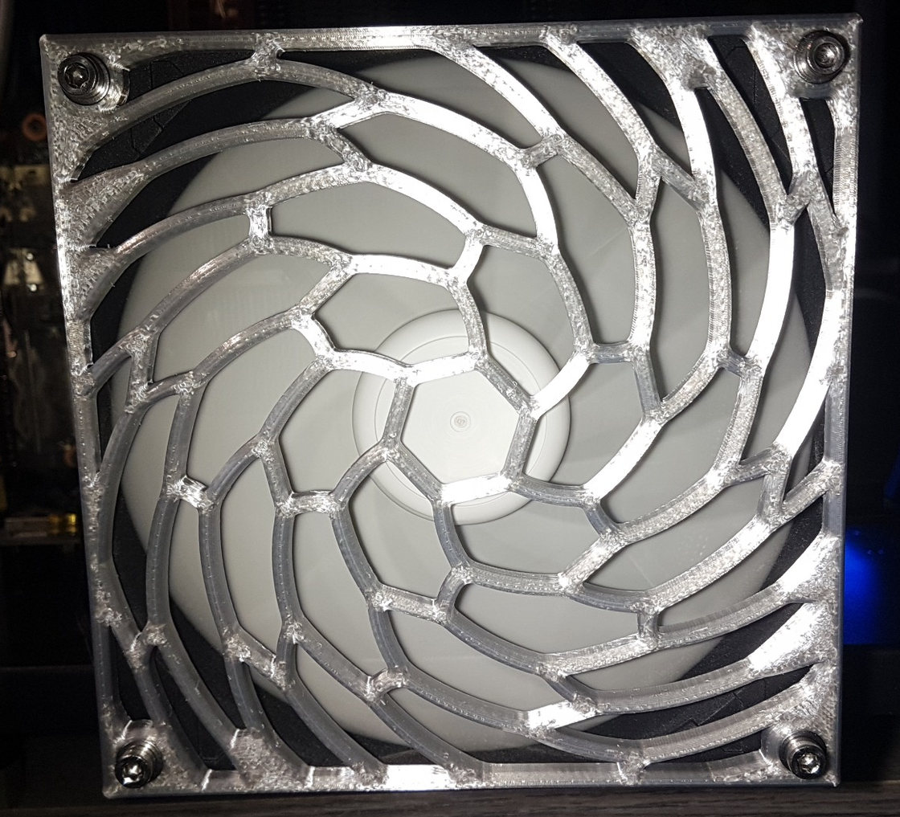
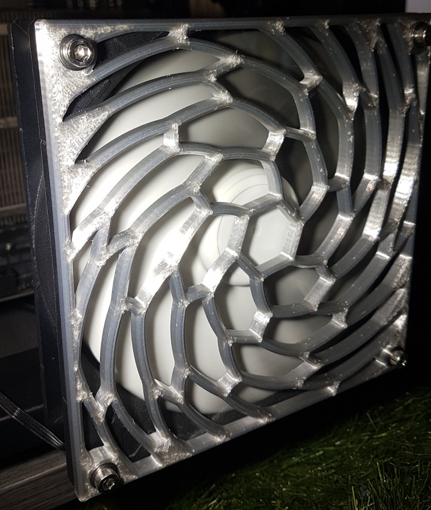
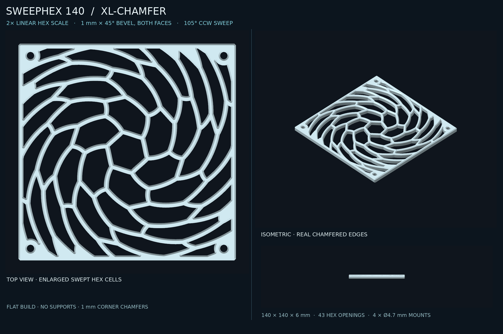

# SweepHex 140 XL — 6 mm chamfered vortex fan guard



**Physically printed and installed** 140 mm fan guard with large helically swept hexagonal apertures, a flat 6 mm body, and true chamfered openings. The two photographs were supplied by the owner on 2026-10-11 and cropped/resized for this repository; they document a physical print, not a simulated render. Material, slicer profile, airflow and acoustic performance were not independently established.



## Printable CAD and sources

| File | Purpose |
| --- | --- |
| [3MF](sweephex140_flat_doublehex_chamfer1.3mf) | Import directly into a slicer; dimensions encoded in millimetres |
| [STL](sweephex140_flat_doublehex_chamfer1.stl) | Printable triangle mesh; units are mm by convention |
| [Parametric Python generator](sweephex140_flat_doublehex_chamfer_parametric.py) | Authoritative source for swirl, apertures, mounts and actual bevels |
| [OpenSCAD wrapper](sweephex140_flat_doublehex_chamfer1.scad) | Imports the committed STL; **not** the parametric source |
| [DXF profile](sweephex140_flat_doublehex_chamfer1.dxf) | 2D profiles of centre and chamfered faces, on named layers |
| [Generation measurements](sweephex140_flat_doublehex_chamfer1.json) | Exact parameters, geometry and mesh check results |
| [CAD preview](assets/cad-preview.png) | Supplementary visual reference, not a photograph |

## Design dimensions

| Parameter | Final print design |
| --- | ---: |
| Overall dimensions | **140 × 140 × 6 mm** |
| Mounting-hole pitch | **124.5 × 124.5 mm** (centres ±62.25 mm) |
| Mounting through-holes | **Ø4.7 mm** central bore, approx. Ø6.7 mm chamfer mouths |
| Main airflow apertures | **43** larger swept hexagon cells |
| Hexagon starting circumradius | 13.6 mm (2× preceding 6.8 mm version) |
| Radial sweep | **105° anticlockwise** at r = 76 mm, viewed from the positive Z / presented face |
| Chamfer | **1 × 1 mm at 45° on both large faces**, perimeter, apertures and mounting holes |
| Straight vertical aperture wall | Z = 1 to 5 mm |
| Nominal central-plane web thickness | 3.2 mm |
| Approximate top/bottom ligament | Around 1.2 mm at some nominal locations; **not verified minimum** |
| Midplane projected open fraction | 58.72% of full square area, including holes |
| Mesh | Single watertight solid; Euler characteristic −92 (47 through-holes) |

The 105° positive swirl direction applies to the top (+Z) view. Confirm the physical mounting orientation before describing the pattern as matching fan rotation. **Swirl is an appearance/design choice, not verified turbulence reduction.** This is an open airflow guard, not a finger-safe grille.

## Print guidance and observed result



Place either broad face flat on the bed, supports disabled. Suggested starting point for a 0.6 mm nozzle: 0.20–0.24 mm layers, 0.60–0.72 mm adaptive line widths, 2–3 walls, and approximately 15–20% infill where applicable. Keep brim/first-layer expansion modest to avoid filling chamfer mouths. PETG may be preferable for hot air paths; the photographed material has **not** been independently identified.

The owner's supplied photographs confirm **one printed and installed example** of this final geometry. No machine/slicer settings, measured hole fit, long-term mechanical testing or airflow/acoustic qualification were supplied. Visible seam and surface artifacts should not be interpreted as CAD dimensional tolerances.

**Manufacturing-rule exception:** [the repository's general 1.3 mm exposed-face minimum](../../../docs/printing.md) is not automatically satisfied by this historical/physically printed design: the earlier CAD estimate is approximately 1.2 mm at the narrowest nominal surface webs, and the exact minimum has not been independently measured. Preserve the published print geometry rather than silently thickening it; remeasure and obtain owner agreement before changing the production version.

## Regeneration and validation

From this directory:

```bash
python -m pip install -r requirements.txt
python sweephex140_flat_doublehex_chamfer_parametric.py
python validate.py
```

Regeneration **overwrites** the STL, 3MF, DXF and JSON in the working directory; use a scratch checkout to compare regenerated artifacts. Shapely constrained triangulation requires Shapely 2.1+. Run `python validate.py` to check the published outputs without rewriting them. The STL/3MF validation checks envelope, watertightness, topology, and expected through-hole count. Structural and aerodynamic qualification remain separate.

For more background, see the [fan-guard family index](../).
